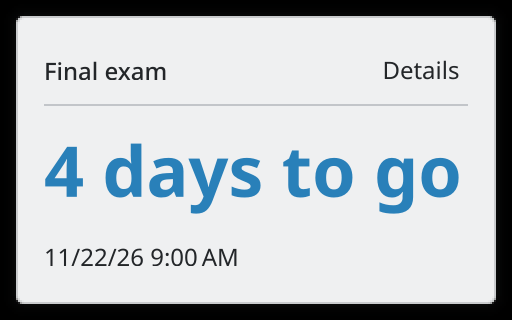

# Gaokao Countdown

[简体中文](README.md)

Count down to the Gaokao, your next exam, or any date you choose. This KDE Plasma 6 widget works on the desktop and in a panel. It starts with the Gaokao, China's national college entrance exam, on June 7 at 9:00 AM local time. The interface follows your desktop language and uses your regional date and time format.



## Using the widget

The desktop card shows the number of calendar days left. The day before the event, it switches to “Tomorrow” and shows how much time remains. On the day itself, it shows “Today”. A custom event keeps its own title throughout.

Select **Details** for the exact time remaining. For a yearly event, the progress bar shows how much of the interval since its last occurrence has elapsed. In a panel, click the compact countdown to open the full card.

## Set a date

Right-click the widget and open its settings. Under **General**, enter a title, date, and time. Leave the title empty to use the built-in Gaokao wording.

- Keep **Repeat every year** selected for an annual event. The widget shows the current occurrence throughout the target day and starts counting toward next year the following day. February 29 falls on February 28 in non-leap years.
- For a **one-time event**, clear **Repeat every year** and select the year. After the target day, the widget displays “Date passed”.
- **Show seconds in details** controls the precision of the detailed view.

## Install and package

Run the following command from the repository root to install or update the widget for your user account. It requires KDE's `kpackagetool6`.

```sh
./install.sh
```

In Plasma, open **Add Widgets** and search for **Gaokao Countdown**. To build a distributable package, run `./package.sh`. To install the resulting archive for the first time:

```sh
kpackagetool6 -t Plasma/Applet -i dist/gaokao-countdown.plasmoid
```

## Test and preview

Run `python3 tests/run-tests.py` for the English and Simplified Chinese regression tests. They require Python 3, Qt 6's `qmltestrunner`, and the KI18n QML module from KDE Frameworks 6.23 or later.

You can preview the widget in its own window on a Wayland desktop such as niri. Install the Plasma SDK, the Plasma runtime, and the desktop containment. After installing the widget, run either command:

```sh
plasmoidviewer -a com.github.plasmoid-gaokao-countdown
plasmoidviewer -a com.github.plasmoid-gaokao-countdown -c org.kde.panel -f horizontal -l topedge -s 850x42
```

For a preview directly from the repository, include the bundled translations in the previewer's search path:

```sh
XDG_DATA_DIRS="$PWD/contents:${XDG_DATA_DIRS:-/usr/local/share:/usr/share}" plasmoidviewer -a "$PWD"
```

The editable Simplified Chinese catalog is [po/zh_CN.po](po/zh_CN.po). Recompile it after editing:

```sh
msgfmt --check po/zh_CN.po -o contents/locale/zh_CN/LC_MESSAGES/plasma_applet_com.github.plasmoid-gaokao-countdown.mo
```

## License

[GPL-3.0-or-later](LICENSE)
