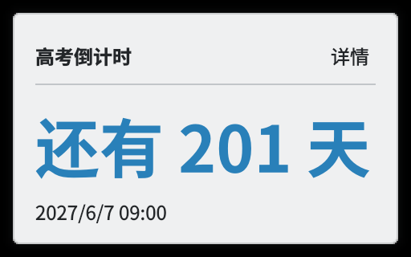
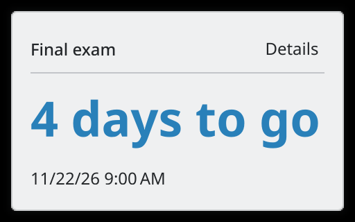

# 高考倒计时

[English](README.en.md)

一个 KDE Plasma 6 桌面和面板挂件。加到桌面就会倒数到下一次高考，默认目标是本地时间 6 月 7 日上午 9 点。你也可以用它记住自己的考试、答辩或项目截止日。挂件支持简体中文和英文，界面语言和日期格式跟随系统设置。

<p>
  
  
</p>

## 在桌面和面板上使用

桌面卡片平时显示还剩多少天，到了前一天会写“明天高考”，并告诉你离开考还有多久。目标当天上午 9 点后，默认高考卡片会写“今天高考”和“祝你考试顺利！”。自定义事件会一直显示你起的标题。

点“详情”可以看精确到时分秒的倒计时。每年重复的事件还会显示从上一次目标时刻走到这一次的进度。面板里只占一小块地方，点一下就能展开卡片。

## 设置自己的日期

右键挂件，打开配置。在“常规”里填标题、日期和时间。标题留空会使用默认的高考文案。

- **每年重复**适合高考或纪念日。目标当天全天保留，次日开始倒数到下一年。每年 2 月 29 日的目标在平年按 2 月 28 日计算。
- **只倒数一次**适合某一场考试或截止日。取消勾选“每年重复”后选择年份。过了目标日期，卡片显示“日期已过”。
- **在详情中显示秒数**控制详细倒计时的精度。

## 安装和打包

从源码安装或更新当前用户的挂件，需要 KDE 的 `kpackagetool6`。在仓库根目录运行：

```sh
./install.sh
```

在 Plasma 的“添加或管理挂件”中搜索“高考倒计时”。要生成可分发的安装包，运行 `./package.sh`。产物是 `dist/gaokao-countdown.plasmoid`，也可以通过命令首次安装：

```sh
kpackagetool6 -t Plasma/Applet -i dist/gaokao-countdown.plasmoid
```

## 开发和测试

逻辑测试使用 Python 3、Qt 6 的 `qmltestrunner` 和 KI18n 6.23 或更新版本的 QML 模块。运行 `python3 tests/run-tests.py`，会分别测试英文和简体中文。

在 niri 等 Wayland 桌面上也可以用 `plasmoidviewer` 打开预览窗口。预览需要 Plasma SDK、Plasma 运行库和桌面容器。安装挂件后，在终端运行：

```sh
plasmoidviewer -a com.github.plasmoid-gaokao-countdown
plasmoidviewer -a com.github.plasmoid-gaokao-countdown -c org.kde.panel -f horizontal -l topedge -s 850x42
```

要从当前源码直接预览，在仓库根目录运行下列命令。它会让预览器在源码的 `contents/locale` 中查找翻译：

```sh
XDG_DATA_DIRS="$PWD/contents:${XDG_DATA_DIRS:-/usr/local/share:/usr/share}" plasmoidviewer -a "$PWD"
```

翻译源文件为 [po/zh_CN.po](po/zh_CN.po)。更新中文后重新生成挂件内的翻译：

```sh
msgfmt --check po/zh_CN.po -o contents/locale/zh_CN/LC_MESSAGES/plasma_applet_com.github.plasmoid-gaokao-countdown.mo
```

## 许可

[GPL-3.0-or-later](LICENSE)
